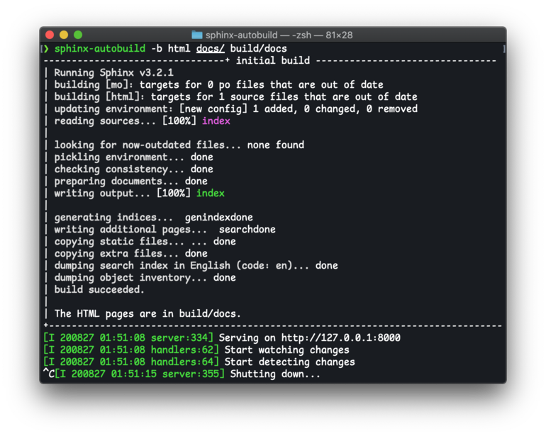

================
sphinx-autobuild
================

.. image:: https://img.shields.io/pypi/v/sphinx-autobuild.svg
   :target: https://pypi.org/project/sphinx-autobuild/
   :alt: Package on PyPI

.. image:: https://img.shields.io/badge/License-MIT-blue.svg
   :target: https://opensource.org/licenses/MIT
   :alt: MIT

Rebuild Sphinx documentation on changes, with hot reloading in the browser.

Installation
============

sphinx-autobuild is available on `PyPI <https://pypi.org/project/sphinx-autobuild/>`__.
It can be installed using pip:

.. code-block:: bash

   pip install sphinx-autobuild

Usage
=====

To build a classical Sphinx documentation set, run:

.. code-block:: bash

   sphinx-autobuild docs docs/_build/html

This will start a server at http://127.0.0.1:8000
and start watching for changes in the ``docs/`` directory.
When a change is detected in ``docs/``, the documentation is rebuilt
and any open browser windows are reloaded automatically.
``KeyboardInterrupt`` (``ctrl`` + ``c``) will stop the server.

Command line options
====================

sphinx-autobuild accepts the same arguments as ``sphinx-build``
(these get passed to sphinx-build on each build).
It also has a few additional options,
which can seen by running ``sphinx-autobuild --help``:

.. code-block:: console

   $ sphinx-autobuild --help
   usage: sphinx-autobuild [OPTIONS] SOURCEDIR OUTPUTDIR [FILENAMES...]

   ...

   autobuild options:
     --port PORT           port to serve documentation on. 0 means find and use a free port
     --host HOST           hostname to serve documentation on
     --re-ignore RE_IGNORE
                           regular expression for files to ignore, when watching for changes
     --ignore IGNORE       glob expression for files to ignore, when watching for changes
     --no-initial          skip the initial build
     --open-browser        open the browser after building documentation
     --delay DELAY         how long to wait before opening the browser
     --watch DIR           additional directories to watch
     --pre-build COMMAND   additional command(s) to run prior to building the documentation
     --post-build COMMAND  additional command(s) to run after building the documentation

Using with Makefile
-------------------

    FYI: Sphinx is planning to `move away from`_ using `Makefile`.

To use sphinx-autobuild with the Makefile generated by Sphinx,
add the following to the end of the Makefile:

.. code-block:: make

   livehtml:
      sphinx-autobuild "$(SOURCEDIR)" "$(BUILDDIR)" $(SPHINXOPTS) $(O)

``make livehtml`` will now invoke sphinx-autobuild.

    If you generated the `Makefile` with an older version of sphinx,
    this syntax might not work for you.
    Consider `updating to the newer structure`_.

.. _move away from: https://github.com/sphinx-doc/sphinx/issues/5618#issuecomment-502415633
.. _updating to the newer structure: https://github.com/sphinx-doc/sphinx/blob/v3.0.0/sphinx/templates/quickstart/Makefile.new_t

Automatically opening the browser
---------------------------------

sphinx-autobuild can open the homepage of the generated documentation
in your default browser.
Passing ``--open-browser`` will enable this behaviour.
The browser opens only after the server is ready to accept connections.

Automatically selecting a port
------------------------------

sphinx-autobuild asks the operating system for a free port number
and use that for its server.
Passing ``--port=0`` will enable this behaviour.

Workflow suggestions
====================

Working on a Sphinx HTML theme
------------------------------

When working on a Sphinx HTML theme,
add the source directory of the theme as a watch directory.

.. code-block:: bash

   sphinx-autobuild docs docs/_build/html --watch path/to/theme

Sphinx 8.2.1 or newer copies changed static files even when no documents change.
HTML template changes also trigger output updates, so ``-a`` is normally unnecessary.
See `Relevant Sphinx Bugs`_ for exceptions.

Working on multiple projects
----------------------------

When working on multiple Sphinx documentation projects simultaneously,
it is required to use different output directories for each project.
It is also recommended to use ``--port=0`` and ``--open-browser``
to avoid needing to manually manage ports and opening browser windows
(which can get tedious quickly).

.. code-block:: bash

   sphinx-autobuild --port=0 --open-browser pikachu/docs pikachu/docs/_build/html &
   sphinx-autobuild --port=0 --open-browser magikarp/docs magickarp/docs/_build/html &

Notifications for build cycles
------------------------------

As an example of using the ``--pre-build`` and ``--post-build`` arguments,
the command below uses `notify-send` to send a notification when a build
starts and finishes.

.. code-block:: bash

   sphinx-autobuild docs docs/_build/html/ \
      --pre-build 'notify-send "sphinx-autobuild: build start"' \
      --post-build 'notify-send "sphinx-autobuild: build end"'

Relevant Sphinx Bugs
====================

Older Sphinx versions can skip static-file updates (`issue #34`_).
Upgrade to Sphinx 8.2.1 or newer (see the `Sphinx 8.2 release notes`_),
or pass ``-a`` to write all output files on each build.

.. _issue #34: https://github.com/sphinx-doc/sphinx-autobuild/issues/34
.. _Sphinx 8.2 release notes: https://www.sphinx-doc.org/en/master/changes/8.2.html

Debugging
=========

If the ``SPHINX_AUTOBUILD_DEBUG`` environment variable is present,
is not ``""`` (the empty string) or ``0``,
and a file change is detected,
its path and the currently active ignore expressions are printed.
This is to help setting up the ignore expressions correctly.

Acknowledgements
================

This project stands on the shoulders of giants,
without whom this project would not be possible.

Many thanks to everyone who has `contributed code`_ as well as
participated in `discussions on the issue tracker`_.
This project is better thanks to your contribution.

.. _contributed code: https://github.com/sphinx-doc/sphinx-autobuild/graphs/contributors
.. _discussions on the issue tracker: https://github.com/sphinx-doc/sphinx-autobuild/issues
